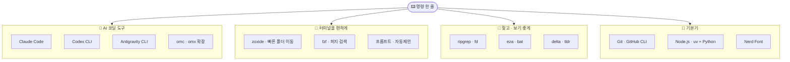

<div align="center">

# 🛠️ dev-setup

**명령 한 줄로 끝내는 AI 코딩 터미널 환경**<br>
Claude Code · Codex · Antigravity 와 빠르고 편한 터미널 도구를 한 번에 설치합니다.

🪟 Windows · 🍎 macOS · 🐧 Linux (Ubuntu/Debian)

[](https://github.com/hd0126/dev-setup/actions/workflows/ci.yml)
[](LICENSE)

[설치하기](#-설치-3단계) · [무엇이 설치되나](#-한눈에-보기) · [바로 써보기](#-설치-후-바로-써보기) · [도구 소개](#-도구-소개) · [문제 해결](#-문제-해결)

</div>

> 🐛 **막혔나요?** [이슈 열기](https://github.com/hd0126/dev-setup/issues/new/choose) — 운영체제와 에러 메시지만 적어 주세요 (초보 환영!). 설치가 실패하면 스크립트가 내용이 채워진 이슈 링크를 바로 보여 줍니다.
>
> ⭐ 도움이 됐다면 우측 상단 **Star**를 눌러 주세요.

---

## 🧭 한눈에 보기



**용도를 보고 고르세요.** Windows는 설치 전에 체크박스 메뉴가 나와서 빼고 싶은 항목을 끌 수 있습니다.

| 분류 | 도구 | 이런 때 씁니다 | 🪟 | 🍎 | 🐧 |
|---|---|---|:-:|:-:|:-:|
| 🤖 AI 코딩 | [Claude Code](#-claude-code) | 터미널에서 말로 코드 작성·수정·리뷰 | ✅ | ✅ | ✅ |
| | [Codex CLI](#-codex-cli) | OpenAI의 코딩 에이전트 | ✅ | ✅ | ✅ |
| | [Antigravity CLI](#-antigravity-cli-agy) | Google의 코딩 에이전트 (Gemini CLI 후속) | ✅ | ✅ | ✅ |
| | [omc](#-omc--omx) | Claude Code 멀티에이전트 플러그인 | 📋 | 📋 | 📋 |
| | [omx](#-omc--omx) | Codex 멀티에이전트 확장 | ✅ | ✅ | ✅ |
| 🐚 터미널 | [zoxide](#-zoxide) | `z 키워드`로 폴더 바로 이동 | ✅ | ✅ | ✅ |
| | [fzf](#-fzf) | 명령 기록·파일을 퍼지 검색 (`Ctrl+R` / `Ctrl+T`) | ✅ | ✅ | ✅ |
| | [프롬프트](#-프롬프트) | 폴더·Git 브랜치·성공/실패 표시 | ✅ 자체 | ✅ Starship | ✅ Starship |
| | [zsh 플러그인 3종](#-zsh-플러그인) | 회색 자동제안 · 오타 색상 · ↑↓ 부분 검색 | — | ✅ | ✅ |
| 🔎 찾기·보기 | [ripgrep](#-ripgrep) | 파일 **안의 내용** 검색 | ✅ | ✅ | ✅ |
| | [fd](#-fd) | 파일 **이름** 검색 (Ctrl+T 가속) | ✅ | ✅ | ✅ |
| | [eza](#-eza) | 보기 좋은 `ls` → `ll` · `lt` | ✅ | ✅ | ✅ |
| | [bat](#-bat) | 색깔 있는 `cat` | ✅ | ✅ | ✅ |
| | [delta](#-delta) | 읽기 쉬운 `git diff` | ✅ | ✅ | ✅ |
| | [tldr](#-tldr) | 예시 위주 명령어 도움말 | ✅ | ✅ | ✅ |
| 🧱 기본기 | [Git · GitHub CLI](#-git--github-cli) | 버전 관리 · PR/이슈 | ✅ | ✅ | ✅ |
| | [Node.js LTS](#-nodejs-lts) | omc·omx·MCP 서버 실행에 필요 | ✅ | ✅ | ✅ |
| | [uv + Python](#-uv--python) | 최신 Python과 빠른 패키지 관리 | ✅ | ✅ | ✅ |
| | [Nerd Font](#-nerd-font) | 프롬프트·아이콘 글자 깨짐 방지 | ✅ | ✅ | 수동 |
| | PowerShell 7 | 최신 PowerShell (프로필이 사용) | ✅ | — | — |

✅ 자동 설치 · 📋 설치 끝에 명령 안내(로그인 후 붙여넣기) · — 해당 없음

<details>
<summary>운영체제별 차이 자세히</summary>

- **Windows** — Starship은 메뉴에 있지만 **기본 해제**입니다. 대신 외부 프로그램 없이 그리는 순수 PowerShell 프롬프트를 씁니다(Enter마다 훨씬 빠름). zsh 플러그인 대신 PowerShell 내장 예측(회색 제안)이 같은 역할을 합니다. `cat`은 PowerShell 기본 동작을 그대로 두고 `bat`은 따로 실행합니다.
- **macOS** — Homebrew가 없으면 먼저 설치합니다. Nerd Font는 설치되지만 **터미널 앱의 폰트 설정은 직접 바꿔야** 합니다.
- **Linux** — Ubuntu 22.04에는 eza·delta·tldr 패키지가 없어 건너뜁니다(24.04+는 설치). Ubuntu에서는 `bat`→`batcat`, `fd`→`fdfind` 이름이지만 별칭으로 자동 처리합니다. Nerd Font는 [수동 설치](#-nerd-font)입니다.

</details>

---

## 🚀 설치 (3단계)

### ① 명령 한 줄 실행

**🪟 Windows** — PowerShell 창에 붙여넣기 (관리자 권한 불필요)

```powershell
irm https://raw.githubusercontent.com/hd0126/dev-setup/main/install.ps1 | iex
```

**🍎 macOS · 🐧 Linux** — 터미널에 붙여넣기 (중간에 비밀번호를 물을 수 있음)

```bash
curl -fsSL https://raw.githubusercontent.com/hd0126/dev-setup/main/install.sh | bash
```

### ② 새 터미널 열기

PATH와 설정은 **새로 연 터미널**부터 적용됩니다. Windows는 **PowerShell 7(`pwsh`)** 창을 여세요.

### ③ 확인하고 로그인

```bash
claude --version     # 버전이 나오면 성공
claude               # 첫 실행 시 브라우저로 로그인
```

설치가 끝나면 화면 아래에 **Claude Code 플러그인 명령**(omc 등)이 나옵니다. 로그인한 뒤 그대로 붙여넣으면 됩니다. ([전체 명령](#-claude-code-플러그인))

<details>
<summary>설치 화면은 이렇게 보입니다 (Windows)</summary>

```text
=== Packages to install  (14 / 15 selected) ===
  Up/Down: move  |  Space: toggle  |  A: select all  |  Enter: confirm  |  Esc: cancel

  > [v] Node.js LTS  JS runtime. Keep this on: the omc plugin's hooks, omx and npx-based MCP servers ...
    [v] Git  Version control. Required for GitHub CLI and Claude Code.
    [ ] Starship  Optional prompt (off by default). ...
    [v] zoxide  Smart cd based on history. No need to type full path.
    ...

Starting installation...
Checking what is already installed (one winget scan, can take a minute)...
[1/14] Node.js LTS... [OK - already latest]
[2/14] Git... [INSTALLED]
...
Installing AI CLI tools...
[1/4] Claude Code... [OK - already installed (native, self-updating)]
...
All required packages installed successfully.
```

`↑↓`로 이동, `Space`로 켜고 끄기, `Enter`로 다음 단계입니다.

</details>

<details>
<summary>무인 설치 · 미리 보기 · 다시 실행하기</summary>

- **여러 번 실행해도 안전합니다.** 이미 설치된 도구와 이미 들어간 설정은 건너뜁니다. 설치가 끊겼거나 꼬였다면 같은 명령을 다시 실행하세요. 직접 꾸민 `.zshrc`·`.bashrc`도 중복 없이 존중합니다.
- **무인 설치 (Windows)** — 메뉴 없이 기본 구성으로 설치:
  ```powershell
  $env:DEVSETUP_NONINTERACTIVE = 1
  irm https://raw.githubusercontent.com/hd0126/dev-setup/main/install.ps1 | iex
  ```
- **미리 보기 (Windows)** — `$env:DEVSETUP_DRYRUN = 1`로 실행하면 아무것도 설치하지 않고 계획만 보여 줍니다.
- **스크립트 내용을 먼저 보고 싶다면** 위 주소를 브라우저로 열어 보세요. 레포를 클론해서 `install.sh`를 실행하면 내려받지 않고 로컬 파일을 씁니다.
- `curl`이 없는 최소 설치 Ubuntu/Debian: `sudo apt-get update && sudo apt-get install -y curl`
- 소요 시간은 네트워크에 따라 5–15분입니다.

</details>

<details>
<summary>예전 버전으로 설치했던 PC라면</summary>

새 스크립트를 다시 실행하면 이렇게 정리됩니다.

- **Gemini CLI**: 삭제할지 물어봅니다(기본값 N). `~/.gemini` 폴더는 Antigravity CLI가 이어서 쓰므로 그대로 둡니다.
- **npm으로 깔린 claude·codex**: 네이티브판이 있으면 중복 사본을 지웁니다.
- **npm판 omc**: 지우지 않고, 더 이상 업데이트하지 않는다고 알려 줍니다(플러그인 권장).
- **Python 3.12 고정 설치**: 이미 있는 Python은 건드리지 않습니다.

</details>

---

## ⚡ 설치 후 바로 써보기

| 해보기 | 입력 | 무슨 일이 일어나나 |
|---|---|---|
| AI에게 일 시키기 | `claude` | 대화형으로 코드 작성·수정 |
| 폴더 순간이동 | `z proj` | 자주 간 폴더 중 "proj"가 들어간 곳으로 |
| 옛날에 친 명령 찾기 | `Ctrl` + `R` | 기록을 퍼지 검색해서 바로 입력 |
| 파일 경로 넣기 | `Ctrl` + `T` | 파일을 골라 경로를 자동 입력 |
| 폴더 보기 | `ll` / `lt` | 보기 좋은 자세한 목록 / 트리 |
| 변경 내용 보기 | `git diff` | 색과 줄번호가 있는 diff |
| 명령 사용법 | `tldr tar` | 자주 쓰는 예시만 짧게 |

<details>
<summary>전체 단축키 · 명령어 표</summary>

| 명령어 | 설명 |
|--------|------|
| `cc` | `claude --dangerously-skip-permissions` (권한 확인 없이 실행 — [주의](#-claude-code)) |
| `ccc` | `cc --continue` (이전 대화 이어서) |
| `ccr` | `cc --resume` (세션 복구) |
| `z <키워드>` · `zi` | 자주 간 폴더로 이동 · fzf로 골라서 이동 |
| `Ctrl+R` · `Ctrl+T` | 히스토리 퍼지 검색 · 파일 검색 후 경로 삽입 (fd가 있으면 .gitignore 존중) |
| `↑ / ↓` | 입력한 내용으로 시작·포함하는 히스토리 검색 |
| `→` | 회색 자동제안 수락 |
| `ll` / `la` / `lt` | eza 긴 목록 / 숨김 포함 / 트리 |
| `cat <파일>` | macOS·Linux: bat으로 하이라이트 · Windows: 원래 `cat`, 하이라이트는 `bat <파일>` |
| `tldr <명령>` | 예시 위주 도움말 |
| `which <명령>` · `touch <파일>` | 설치 경로 확인 · 빈 파일 생성 (Windows 프로필) |
| `conda` | Conda 초기화 — Windows 프로필 전용 |

</details>

---

## 🧰 도구 소개

> 그림은 각 도구의 공식 저장소에서 가져왔습니다. 사용법은 펼쳐서 보세요.

### 🤖 AI 코딩 도구

#### 🟠 Claude Code

Anthropic의 AI 코딩 에이전트. 터미널에서 말로 코드 작성·수정·디버깅·리뷰를 맡깁니다. 네이티브 설치판이라 Node 없이 실행되고 백그라운드에서 자동 업데이트됩니다. ▶️ [공식 데모 GIF 보기](https://github.com/anthropics/claude-code/blob/main/demo.gif)

```text
$ claude
> 이 함수에 테스트를 작성해줘
● tests/test_parser.py 를 만들고 경계값 케이스 6개를 추가했습니다. 실행해 볼까요?   (실행 예시)
```

> ⚠️ **`cc`는 확인 없이 실행합니다.** `cc` = `claude --dangerously-skip-permissions`라 파일 삭제·명령 실행을 묻지 않습니다. 처음 배우는 동안이나 중요한 데이터가 있는 곳에서는 `claude`를 쓰세요.

<details>
<summary>사용법 · 수동 설치</summary>

```bash
claude                     # 확인을 받으며 실행 (권장)
cc                         # 확인 없이 실행
ccc                        # 이전 대화 이어서 (--continue)
ccr                        # 중단된 세션 복구 (--resume)
cc '버그 찾아서 고쳐줘'      # 한 줄로 시키기
```

수동 설치:

```powershell
irm https://claude.ai/install.ps1 | iex          # Windows
```

```bash
curl -fsSL https://claude.ai/install.sh | bash   # macOS · Linux
```

mac/Linux에서 `cc`는 원래 C 컴파일러 명령입니다. 별칭이 대화형 셸에서 컴파일러를 가리므로, 필요하면 `command cc`나 `/usr/bin/cc`를 쓰세요(스크립트·Makefile은 영향 없음). 이미 `alias cc=...`를 직접 정의해 두었다면 덮어쓰지 않습니다.

</details>

#### 🔵 Codex CLI

OpenAI의 코딩 에이전트. 네이티브 설치판(Node 불필요, 자동 업데이트). 첫 실행 때 `codex login`.


<details>
<summary>사용법 · 수동 설치 · 설치 오류</summary>

```bash
codex                    # 대화형 실행
codex '테스트 작성해줘'    # 한 줄로 시키기
codex login              # OpenAI 계정 로그인
```

```powershell
irm https://chatgpt.com/codex/install.ps1 | iex      # Windows
```

```bash
curl -fsSL https://chatgpt.com/codex/install.sh | sh  # macOS · Linux
```

⚠️ Windows에서 `tar: Cannot connect to C:` 오류가 나면 PATH 앞쪽의 Git용 `tar`(`...\Git\usr\bin`)가 Windows 경로를 원격 주소로 오해한 것입니다. `where.exe tar`로 확인하고, `C:\Windows\System32\tar.exe`가 먼저 잡히는 일반 PowerShell 창에서 다시 실행하세요.

</details>

#### 💎 Antigravity CLI (`agy`)

Google의 터미널 코딩 에이전트이자 **Gemini CLI의 후속**. 네이티브 설치판(Node 불필요, 자동 업데이트). 첫 실행 때 브라우저로 Google 로그인.


<details>
<summary>사용법 · 수동 설치 · Gemini CLI를 쓰던 분께</summary>

```bash
agy                      # 대화형 실행 (첫 실행 시 로그인)
agy plugin import gemini # Gemini CLI 확장을 Antigravity 플러그인으로 옮기기
```

```powershell
irm https://antigravity.google/cli/install.ps1 | iex           # Windows
```

```bash
curl -fsSL https://antigravity.google/cli/install.sh | bash    # macOS · Linux
```

Google은 2026-06-18부터 무료·AI Pro·Ultra 계정의 Gemini CLI 요청을 받지 않습니다(유료 API 키·기업 라이선스만 유지). 그래서 이 스크립트는 Gemini CLI를 더 이상 설치하지 않고, 예전에 깔린 것은 [다시 실행할 때 지울지 물어봅니다](#-설치-3단계). 자세한 이전 방법은 [공식 마이그레이션 안내](https://antigravity.google/docs/gcli-migration)를 보세요.

</details>

#### 🧩 omc · omx

| | oh-my-claudecode (omc) | oh-my-codex (omx) |
|---|---|---|
| |  |  |
| 대상 | Claude Code | Codex CLI |
| 하는 일 | 계획·실행·리뷰 에이전트를 자동으로 나눠 맡기는 멀티에이전트 레이어 | 명확화→계획→실행 워크플로 레이어 |
| 설치 | Claude Code **플러그인** (설치 끝에 명령 안내) | npm (`oh-my-codex`) |
| 써보기 | 세션 안에서 `/omc-setup` → `/autopilot "..."` | `omx setup` → `omx` |
| 링크 | [GitHub](https://github.com/Yeachan-Heo/oh-my-claudecode) | [GitHub](https://github.com/Yeachan-Heo/oh-my-codex) |

<details>
<summary>주요 명령 · 참고 사항</summary>

```bash
# Claude Code 세션 안 (omc)
/omc-setup                      # 초기 설정 (HUD·훅)
/autopilot "REST API 만들어줘"  # 계획→구현→검증 자율 실행
/ralph "승인된 계획 완료까지"    # 완료될 때까지 반복
/team                           # 멀티에이전트 팀

# 터미널 (omx)
omx setup                       # 초기 설정
omx doctor                      # 설치 상태 확인
omx --madmax --high             # 기본 실행
```

- omc 플러그인의 훅과 MCP 서버는 **Node로 실행**됩니다. Node.js를 끄면 조용히 동작하지 않습니다.
- 터미널에서 `omc` 셸 명령도 쓰고 싶다면 npm판(`npm i -g oh-my-claude-sisyphus@latest`)을 따로 설치할 수 있습니다. Windows에서는 C++ 빌드툴이 필요해 실패할 수 있습니다.
- omx는 macOS·Linux에 맞춰져 있고 **네이티브 Windows 지원은 실험적**입니다(WSL2 권장).

</details>

---

### 🐚 터미널을 편하게

#### 📁 zoxide

방문 기록을 학습해서 짧은 키워드만으로 폴더를 이동하는 똑똑한 `cd`.


<details>
<summary>사용법</summary>

```text
z proj            # "proj"가 들어간, 가장 자주 간 폴더로
z my project      # 키워드 여러 개
z ..              # 상위 폴더
z -               # 직전 폴더
zi                # fzf 화면에서 골라서 이동
```

</details>

#### 🔍 fzf

목록에서 오타가 있어도 비슷하면 찾아 주는 **퍼지 검색** UI. 명령 기록(`Ctrl+R`)과 파일(`Ctrl+T`)에 연결돼 있습니다. 예: `dcmnts` → `Documents`


<details>
<summary>사용법</summary>

```text
Ctrl+R   이전 명령 검색 (치는 대로 실시간 필터)
Ctrl+T   파일 검색 → 고르면 경로가 입력됨
Alt+C    폴더를 골라 바로 이동 (macOS·Linux 전용. macOS 기본 터미널은 Option을 Meta로 설정해야 함)
```

```bash
code "$(fzf)"                 # 파일 골라서 열기 (macOS·Linux)
fzf --preview 'cat {}'        # 미리보기 창
```

```powershell
# Windows — 프로세스 골라서 종료
Get-Process | ForEach-Object { "$($_.Id) $($_.ProcessName)" } | fzf | ForEach-Object { Stop-Process -Id ($_ -split ' ')[0] }
```

</details>

#### 🎨 프롬프트

현재 폴더·Git 브랜치·직전 명령 성공(초록 `❯`)/실패(빨강 `❯`)를 보여 줍니다.

| 🍎 macOS · 🐧 Linux — Starship | 🪟 Windows — 순수 PowerShell 프롬프트 |
|---|---|
|  | <pre>…\GitHub\dev-setup on main<br>❯ git status</pre>외부 프로그램을 실행하지 않아 Enter마다 빠릅니다. |

<details>
<summary>Windows에서 Starship을 쓰고 싶다면 · 설정 바꾸기</summary>

Windows 메뉴에서 Starship을 켜서 설치한 뒤 프로필에 한 줄을 추가하세요.

```powershell
'Invoke-Expression (&starship init powershell)' | Add-Content $PROFILE
```

Windows에서 Starship은 **Enter마다 외부 exe를 실행**합니다. 실시간 백신 검사가 있는 PC에서 재 보니 프롬프트 1회에 1.6~2.0초(순수 PS 프롬프트는 17~103ms)였습니다. PC마다 다르지만 그래서 기본값은 순수 PS 프롬프트입니다.

Starship 설정: `~/.config/starship.toml` ([프리셋 모음](https://starship.rs/presets/))

</details>

#### 🧩 zsh 플러그인

macOS·Linux의 zsh에서 입력을 도와주는 플러그인 3종입니다. Windows는 PowerShell 내장 예측이 회색 제안을 대신합니다.

| 자동제안 (zsh-autosuggestions) | 오타 색상 (zsh-syntax-highlighting) |
|---|---|
| <pre>$ git che<i>ckout main</i></pre><sub>(기울어진 부분이 회색 제안 · 실행 예시)</sub> |  →  |
| 기록을 보고 회색으로 제안, `→`로 수락 | 맞는 명령은 초록, 오타는 빨강 |

**↑↓ 부분 검색 (zsh-history-substring-search)** — 입력한 단어가 **들어간** 기록만 위아래로 넘깁니다.

```text
$ git▮          ← "git"까지 치고 ↑
$ git commit -m "fix: typo"     (git이 들어간 직전 명령)
$ git push origin main          (↑ 한 번 더)
```

<details>
<summary>설치 방식</summary>

- macOS: Homebrew로 설치합니다.
- Linux: 자동제안·색상은 apt로, 부분 검색은 apt 패키지가 없어 공식 저장소를 `~/.zsh`로 `git clone`합니다.

</details>

---

### 🔎 찾고 · 보기 좋게

#### 🔎 ripgrep

파일 **안의 내용**을 검색합니다. `grep`보다 훨씬 빠르고 `.gitignore`를 알아서 따릅니다. (fzf는 목록에서 고르는 도구, ripgrep은 내용을 찾는 도구)


<details>
<summary>사용법</summary>

```text
rg "function"           # 현재 폴더 전체에서
rg "TODO" src/          # 특정 폴더만
rg -i "error"           # 대소문자 무시
rg -w "main"            # 단어 단위 ("mainly" 제외)
rg -t py "import"       # Python 파일만
rg -C 3 "catch"         # 앞뒤 3줄 함께
rg -l "TODO"            # 파일 이름만
```

</details>

#### 🗂️ fd

파일 **이름**으로 찾는 빠른 `find`. fzf의 `Ctrl+T`도 fd로 돌아가 `.gitignore`를 존중합니다.


<details>
<summary>사용법</summary>

```text
fd config          # 이름에 config가 들어간 파일
fd -e md           # 확장자가 .md인 파일
fd -H env          # 숨김 파일 포함
```

Ubuntu에서는 명령 이름이 `fdfind`입니다(fzf 연동은 자동 처리).

</details>

#### 📋 eza

색깔·Git 상태를 보여 주는 `ls`. `ll`(자세히) · `la`(숨김 포함) · `lt`(트리) 별칭이 들어갑니다. 아이콘은 macOS에서 켜져 있습니다(Nerd Font 필요).


#### 🦇 bat

문법 색상과 줄 번호가 있는 `cat`. macOS·Linux에서는 `cat`이 bat으로 바뀌고, Windows에서는 `bat 파일`로 실행합니다.


#### 🔀 delta

`git diff`를 색깔·줄 번호·단어 단위 강조로 보여 줍니다. git pager 설정이 **없을 때만** 자동 적용합니다.


<details>
<summary>되돌리기</summary>

```bash
git config --global --unset core.pager
git config --global --unset interactive.diffFilter
```

</details>

#### 📖 tldr

`man` 대신 자주 쓰는 예시만 보여 주는 도움말 (tealdeer).


---

### 🧱 기본기

#### 🐙 Git · GitHub CLI

Git은 버전 관리, GitHub CLI(`gh`)는 터미널에서 PR·이슈를 다룹니다. 둘은 별개의 도구가 아니라 GitHub CLI의 명령 이름이 `gh`입니다.


<details>
<summary>자주 쓰는 명령</summary>

```text
git clone <repo>  ·  git commit -m "메시지"  ·  git push
gh auth login     ·  gh pr create            ·  gh issue list
```

</details>

#### 🟩 Node.js LTS

**끄지 마세요.** Claude Code·Codex·Antigravity 본체는 Node 없이 돌아가지만, 아래는 Node가 있어야 동작합니다.

- **omc 플러그인** — 훅과 MCP 서버를 `node`로 실행 (없으면 조용히 동작 안 함)
- **omx** — npm으로 설치
- `npx`로 실행하는 MCP 서버들

Windows 메뉴에서 Node를 끄고 PC에도 없으면 경고를 보여 줍니다.

#### 🐍 uv + Python

**uv**가 최신 안정판 Python을 직접 설치·관리합니다(버전을 고정하지 않아 스크립트가 낡지 않음). pip·venv를 대신하는 아주 빠른 패키지 관리자입니다.


<details>
<summary>사용법 · 기존 Python과의 관계</summary>

```bash
python --version          # 새 PC 기준: uv가 설치한 최신 Python
uv venv                   # 가상환경
uv pip install <패키지>    # 패키지 설치
uv add <패키지>            # 프로젝트에 의존성 추가
uv run <스크립트>          # 환경을 알아서 맞춰 실행
uv python list            # 설치된/가능한 버전
uv python upgrade         # 패치 업그레이드
```

- **기존 Python 환경은 건드리지 않습니다.** Windows는 PATH에 다른 Python이 있으면(Store판 포함) 건너뜁니다. Linux·macOS는 `python3`가 pyenv·conda·brew 등 `/usr/bin` 밖에서 잡히거나 `pip --user` 패키지가 있으면 `python3.x` 명령만 추가하고 기본 `python3`는 그대로 둡니다. 이때는 `uv run python`으로 실행하고, 기본값으로 바꾸려면 `uv python install --default`.
- **전역 `pip install` 대신 uv를 쓰세요.** 최근 Ubuntu/Debian의 시스템 Python은 전역 설치를 막아 둡니다(externally-managed 에러).

</details>

#### 🔤 Nerd Font

프롬프트 기호와 아이콘이 □로 깨지지 않게 하는 폰트(JetBrainsMono Nerd Font).


<details>
<summary>운영체제별 적용</summary>

- **Windows** — 자동 설치하고 Windows Terminal·예전 콘솔 창의 기본 폰트로 설정합니다. Starship을 안 써도 필요합니다: 예전 콘솔 창의 기본 폰트 Consolas에는 프롬프트 화살표 `❯`가 없어 □로 깨집니다.
- **macOS** — 자동 설치. **터미널 앱 설정에서 폰트를 `JetBrainsMono Nerd Font`로 직접 바꿔야** 적용됩니다(Terminal.app · iTerm2 · Ghostty).
- **Linux** — 수동: [nerdfonts.com](https://www.nerdfonts.com/font-downloads)에서 JetBrainsMono 내려받기 → `~/.local/share/fonts`에 풀기 → `fc-cache -f` → 터미널 폰트 변경
- VS Code 등 다른 앱은 각 앱 설정에서 폰트를 바꾸세요.

</details>

---

## 🔌 Claude Code 플러그인

로그인이 필요해서 자동으로 실행하지 않습니다. 설치 끝에 같은 명령이 출력됩니다.

```bash
claude auth login

# oh-my-claudecode (omc)
claude plugin marketplace add Yeachan-Heo/oh-my-claudecode
claude plugin install oh-my-claudecode@omc

# Codex 플러그인
claude plugin marketplace add openai/codex-plugin-cc
claude plugin install codex@openai-codex

# honeypot 마켓플레이스
claude plugin marketplace add https://github.com/orientpine/honeypot.git

# Karpathy 가이드라인
claude plugin marketplace add forrestchang/andrej-karpathy-skills
claude plugin install andrej-karpathy-skills@karpathy-skills
```

---

## 🔧 설치 후 자동 적용되는 설정

<details>
<summary>🪟 Windows — PowerShell 프로필</summary>

`Microsoft.PowerShell_profile.ps1`이 `$PROFILE`에 내려받아집니다(기존 프로필은 날짜를 붙여 백업).

| 기능 | 설명 |
|------|------|
| 프롬프트 | 외부 프로그램 없는 순수 PowerShell. `.git/HEAD`를 직접 읽어 브랜치 표시, 경로 단축, 성공/실패에 따라 `❯` 색 |
| zoxide · fzf | `z`, `Ctrl+R`, `Ctrl+T` (fd가 있으면 fd로) |
| eza | `ll` · `la` · `lt` |
| 자동제안 | PSReadLine 예측 — 회색 제안, `→`로 수락 |
| cc / ccc / ccr | Claude Code 단축 명령 |
| SSH agent | ssh-agent 서비스가 **이미 실행 중일 때만** `.ssh`의 키를 자동 등록 |
| 로드 시간 | 시작할 때 `PowerShell loaded in {N}ms` 표시 |
| 도구 캐시 | 도구 유무와 zoxide 초기화 결과를 파일 하나에 저장. 프로필·도구 exe·PATH가 바뀌면 자동으로 다시 만듦 |

</details>

<details>
<summary>🐧 Linux / WSL — .bashrc · .zshrc</summary>

| 기능 | 설명 |
|------|------|
| Starship | 프롬프트 (init 결과를 `~/.cache/starship_init_*`에 캐시) |
| zoxide · fzf | `z`, `Ctrl+R`, `Ctrl+T` (fd 기반, `fdfind` 자동 처리) |
| zsh 플러그인 | 자동제안 · 오타 색상 · ↑↓ 부분 검색 |
| eza · bat · delta | `ll`/`la`/`lt`, `cat`=bat(`batcat` 자동 처리), git pager=delta(설정이 없을 때만) |
| PATH | `~/.npm-global/bin`(sudo 없는 npm 전역), `~/.local/bin`(uv·네이티브 CLI) |
| SSH agent | 에이전트를 재사용(`~/.ssh/agent.env`)하고 첫 개인키 등록. 키가 없으면 아무것도 안 함 |
| 로드 시간 | `[shell] loaded in Xms` |

</details>

<details>
<summary>🍎 macOS — .zshrc</summary>

| 기능 | 설명 |
|------|------|
| Starship | 프롬프트 (`~/.cache/starship_init_zsh.zsh` 캐시) |
| zoxide · fzf | `z`, `Ctrl+R`, `Ctrl+T` (fd 기반) |
| zsh 플러그인 | 자동제안 · 오타 색상 · ↑↓ 부분 검색 |
| eza · bat · delta | `ll`/`la`/`lt`(아이콘), `cat`=bat, git pager=delta(설정이 없을 때만) |
| Homebrew | `shellenv` 적용 — Apple Silicon·Intel 모두 |
| SSH agent | macOS 키체인이 자동 관리 |
| 로드 시간 | `[shell] loaded in Xms` |

</details>

<details>
<summary>📝 스크립트 없이 설정만 직접 넣고 싶다면</summary>

**가장 쉬운 방법은 설치 명령을 다시 실행하는 것입니다.** 이미 있는 것은 건너뛰고 빠진 설정만 추가합니다.

**Windows** — 프로필만 내려받기 (**반드시 `pwsh` 7에서** 실행. 5.1에서 실행하면 5.1 프로필 위치에 저장돼 시작할 때마다 에러가 납니다):

```powershell
$profileUrl = "https://raw.githubusercontent.com/hd0126/dev-setup/main/Microsoft.PowerShell_profile.ps1"
New-Item -ItemType Directory -Force -Path (Split-Path $PROFILE) | Out-Null
if (Test-Path $PROFILE) { Copy-Item $PROFILE "$PROFILE.$(Get-Date -Format 'yyyyMMdd_HHmmss').bak" }
Invoke-WebRequest -Uri $profileUrl -OutFile $PROFILE
```

**bash** — `.bashrc` 끝에 핵심 설정 추가 (zsh 플러그인·eza·bat·fd 연결은 제외한 축약본):

```bash
cat >> ~/.bashrc << 'EOF'
alias cc='claude --dangerously-skip-permissions'
alias ccc='cc --continue'
alias ccr='cc --resume'
case ":$PATH:" in *":$HOME/.npm-global/bin:"*) ;; *) export PATH="$HOME/.npm-global/bin:$PATH" ;; esac
case ":$PATH:" in *":$HOME/.local/bin:"*) ;; *) export PATH="$HOME/.local/bin:$PATH" ;; esac
command -v zoxide &>/dev/null && eval "$(zoxide init bash --cmd z)"
if command -v fzf &>/dev/null; then
    if fzf --bash &>/dev/null; then eval "$(fzf --bash)"
    elif [ -f /usr/share/doc/fzf/examples/key-bindings.bash ]; then source /usr/share/doc/fzf/examples/key-bindings.bash; fi
fi
command -v starship &>/dev/null && eval "$(starship init bash)"
EOF
```

**zsh** — `.zshrc` 끝에 추가:

```bash
cat >> ~/.zshrc << 'EOF'
alias cc='claude --dangerously-skip-permissions'
alias ccc='cc --continue'
alias ccr='cc --resume'
case ":$PATH:" in *":$HOME/.npm-global/bin:"*) ;; *) export PATH="$HOME/.npm-global/bin:$PATH" ;; esac
case ":$PATH:" in *":$HOME/.local/bin:"*) ;; *) export PATH="$HOME/.local/bin:$PATH" ;; esac
command -v zoxide &>/dev/null && eval "$(zoxide init zsh --cmd z)"
if command -v fzf &>/dev/null; then
    if fzf --zsh &>/dev/null; then source <(fzf --zsh)
    elif [ -f /usr/share/doc/fzf/examples/key-bindings.zsh ]; then source /usr/share/doc/fzf/examples/key-bindings.zsh; fi
fi
command -v starship &>/dev/null && eval "$(starship init zsh)"
EOF
```

적용: 새 터미널을 열거나 `source ~/.bashrc` / `source ~/.zshrc`

</details>

---

## 🩺 문제 해결

<details>
<summary>아이콘이나 <code>❯</code>가 □로 보여요</summary>

터미널 폰트가 Nerd Font가 아닙니다.
- Windows Terminal: 설정 → 기본값 → 모양 → 글꼴 → `JetBrainsMono Nerd Font`
- 예전 콘솔 창: 제목 표시줄 → 속성 → 글꼴 → `JetBrainsMono Nerd Font Mono`
- macOS 터미널 앱 · VS Code: 각 앱 설정에서 폰트 변경

</details>

<details>
<summary><code>claude</code>·<code>codex</code>를 찾을 수 없다고 나와요</summary>

설치한 창이 아니라 **새로 연 터미널**에서 실행하세요(Windows는 `pwsh`). 그래도 안 되면 설치 명령을 다시 실행하세요 — PATH를 다시 확인합니다.

</details>

<details>
<summary>새로 설치한 도구가 Windows 프로필에 반영되지 않아요</summary>

프로필은 도구 유무를 캐시해 둡니다. 프로필이나 도구 exe가 바뀌거나, 새 도구 설치로 **PATH가 바뀌면** 자동으로 다시 만듭니다. 이미 PATH에 있는 폴더(예: `WinGet\Links`)에 새 도구가 들어가 PATH가 그대로면 알아채지 못하니(설치 스크립트로 설치하면 자동), 그럴 때는:

```powershell
Remove-Item ([IO.Path]::GetFullPath("$env:TEMP\pwsh_profile_cache.ps1"))
```

`GetFullPath`로 감싸는 이유: 계정명에 한글·공백이 있으면 `$env:TEMP`가 짧은 이름(`C:\Users\홍길동~1\...`)이 되고, 그 경로로는 `Remove-Item`이 파일을 지우지 못합니다.

</details>

<details>
<summary>Starship을 업데이트했는데 그대로예요 (macOS·Linux)</summary>

init 결과를 캐시합니다. 지우면 다음 셸에서 다시 만듭니다.

```bash
rm ~/.cache/starship_init_bash.sh   # bash
rm ~/.cache/starship_init_zsh.zsh   # zsh
```

</details>

<details>
<summary>npm 설치가 C++ 빌드 오류나 네트워크 오류로 실패해요</summary>

설치 스크립트가 원인을 화면에 보여 주고 로그를 저장합니다(Windows: `%TEMP%\omc-install-*.log`). 회사망이라면 `npm config set proxy http://<주소>:<포트>`와 `https-proxy`를 설정한 뒤 다시 실행하세요.

</details>

---

## 🤝 기여 · 라이선스

- 이슈와 [Pull Request](https://github.com/hd0126/dev-setup/pulls) 환영합니다. 변경 이력은 [CHANGELOG](CHANGELOG.md), 할 일은 [BACKLOG](BACKLOG.md)에 있습니다.
- 등록된 이슈는 관리자가 AI 봇 검토를 돌려 진단 코멘트나 수정 PR을 남깁니다.
- [MIT License](LICENSE) — 자유롭게 사용·수정·재배포할 수 있습니다.
